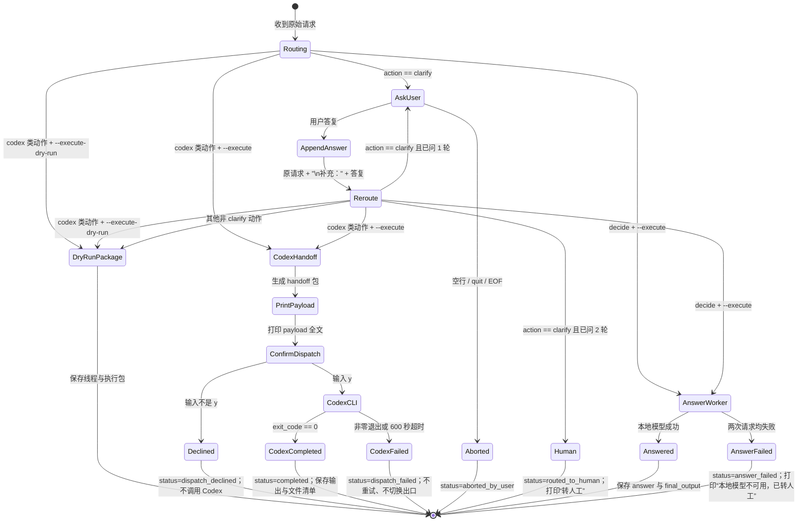

# Super-agent 执行侧阶段一：Clarify 回路与 Answer Worker

默认入口不带 `--execute` 或 `--execute-dry-run` 时仍委托给原有 `try_router_semantic` CLI。`--execute-dry-run` 保持原执行层 dry-run；`--execute` 让 decide 走本地 Answer Worker，Codex 类动作则先打印 handoff payload 并等待用户明确输入 `y`，再调用本机 Codex CLI。没有 `y` 不派发；任何实际派发都记录为独立事件，`automatic_dispatch_allowed` 仍为 `false`。

## 流程



## 线程记录

每个新请求创建一个 `thread_id`。同一线程的 JSONL 快照会原位更新，完整澄清历史按轮次追加到 `clarification_rounds`；`clarification_round` 同时保存最近一轮 `{question, answer}`。每项历史还保留增强请求和重路由结果。最多两轮；空答复或 `quit` 中止，第二轮仍为 clarify 则熔断转人工。decide 在 `--execute` 下把回答正文保存到 `final_output` 并打印；Codex handoff 在用户确认后才执行，结果写入同一 thread。

追问来自 `light_decider.question`：优先采用路由输出附带的问题包；否则按策略给出的 reason 选择缺失点模板。若模型只判定 `clarify`、没有指出具体缺项，执行层会调用本地 Ollama 模型，结合原请求和已有上下文生成针对性追问，并把识别出的缺失点写入 thread。生成失败时使用说明对象、触发条件、预期操作或参数范围的降级问题。

## 使用

```powershell
python executor.py
python executor.py --execute-dry-run --text "请求内容"
python executor.py --execute --text "请求内容"
```

第一行是兼容路径，行为保持原路由 CLI；第二行启用澄清回路和 dry-run；第三行启用 decide 本地回答，并对 Codex handoff 增加人工确认门。线程日志默认写入 `logs/executor_threads.jsonl`，该文件被 `.gitignore` 排除，避免把原始请求写入版本库。

## Decide 出口：本地 Answer Worker

`--execute` 下仅当最终路由动作为 `decide` 时调用 Worker。它向同一 Ollama 实例的原生 `/api/chat` 发送当前请求文本；配置的 Base URL 缺省带 `/v1`，Worker 会将该版本路径解析为服务根路径。原生接口用于确保 `num_ctx`、`keep_alive` 等 Ollama 参数生效；`/v1/chat/completions` 另行作为兼容接口冒烟测试。经过澄清后的请求会包含已追加的“补充”答复。系统提示固定为：`直接回答用户的问题，不提路由、不解释自己是执行层。` Worker 使用进程内串行锁，不并发处理请求。

| 配置 | 环境变量 | 缺省值 |
|---|---|---|
| Ollama Base URL | `LIGHT_DECIDER_ANSWER_BASE_URL` | `http://localhost:11434/v1` |
| 模型 | `LIGHT_DECIDER_ANSWER_MODEL` | `qwen2.5:7b-instruct` |
| HTTP 超时 | 固定缺省 | 120 秒 |
| 上下文上限 | 原生 `/api/chat` 的 `options.num_ctx` | 4096 |
| 模型保活 | 原生 `/api/chat` 的 `keep_alive` | `60s` |
| 温度 | 固定 | 0.2 |

成功时 thread 添加 `answer`（模型名、耗时、全文、token 用量、尝试次数），并将同一正文保存到 `final_output`。接口没返回用量时 `usage=null`。连接失败、超时、HTTP 错误或响应格式异常会重试一次；两次都失败则线程状态为 `answer_failed`，记录错误，打印 `本地模型不可用，已转人工`，不切换到其他出口。

## 第二步：Codex 出口（人工确认门）

仅在 `--execute` 下，对 `codex`、`codex+declare_default` 与 `codex+check_first` 执行真实调用。执行层先按现有规则构造 handoff 包，打印 `payload` 全文，再提示 `确认派发给 Codex？(y/N)`。只有去除首尾空格后等于 `y`（大小写不敏感）才继续；回车、`N` 或其他输入都将 thread 标为 `dispatch_declined`，不调用 CLI。`--execute-dry-run` 仍只保存 dry-run 包。

工作目录由 `LIGHT_DECIDER_CODEX_WORKDIR` 指定；未设置时使用项目下 `workspace/codex_runs/<thread_id>/`，并在派发前创建。项目根目录不会作为缺省工作目录。Codex 通过 `codex exec` 启动，工作目录由 `-C` 指定，沙箱为 `workspace-write`；调用关闭 `/tmp`、`$TMPDIR` 等额外写入根并清空额外 writable roots，CLI 自报的有效可写范围应仅为该 thread 的工作目录。调用不添加其他可写目录，超时 600 秒，不自动重试。完整 handoff payload 经 stdin 传给 Codex；check_first 另附只检查当前工作目录、找不到项目约定则停止且不创建/修改文件的限制。

状态流为 `awaiting_dispatch_confirmation` →（非 `y`）`dispatch_declined`，或（`y`）`dispatched` → `completed` / `dispatch_failed`。派发事件独立保存 `confirmed_by_user`、实际命令、sandbox、工作目录、退出码、耗时、最终输出全文及工作目录内新增/修改/删除文件清单。执行包中的 `automatic_dispatch_allowed` 始终为 `false`。CLI 错误或超时会记录失败结果，不重试、不改走 Answer Worker 或其他出口。Codex 输出不会触发第二轮 clarify 回路。

| 配置 | 环境变量 / 缺省值 |
|---|---|
| 工作目录 | `LIGHT_DECIDER_CODEX_WORKDIR`；缺省 `workspace/codex_runs/<thread_id>/` |
| 命令 | `codex exec` |
| 文件系统沙箱 | `workspace-write`，仅当前工作目录可写；不设置额外 writable roots |
| 超时 | 600 秒 |
| 重试 | 0 次 |
| 派发确认 | 仅 `y`；默认拒绝 |

## 验证

运行 `python -B scripts/drill_executor_clarify_loop.py`，覆盖 clarify→codex、clarify→decide、两轮后转人工，并核对不带开关时与原入口逐字节一致。第二步的真实 Codex 派发、拒绝门、空目录 check_first 演练记录在 `phase2_codex_live_report.md`。Ollama 安装、Answer Worker 六题实跑和服务失败演练记录在 `install_and_answer_worker_report.md`。
